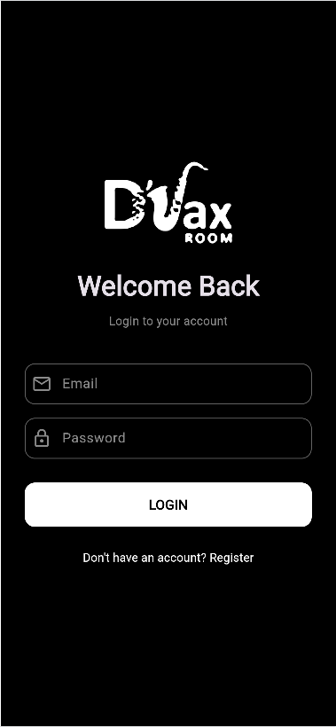
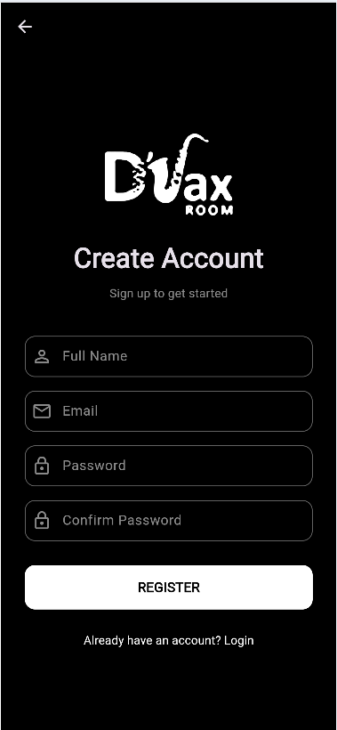

# DSaxroom

A simple Flutter Login and Registration Application.

## About the Project

DSaxroom App is a beginner-level Flutter project developed as a practical exercise to understand Flutter widgets, form inputs, and screen navigation.

## Features

- Login page
- User registration page
- DSaxroom logo
- Navigation between Login and Registration pages
- Email and password input fields
- Password confirmation field

## Technologies Useds

- Flutter
- Dart
- Visual Studio Code

## Application Screenshots

### Login Page

### Registration Page

## How to Run the Project

1. Clone this repository.
2. Open the project folder in Visual Studio Code.
3. Run `flutter pub get`.
4. Run `flutter run -d chrome`.

## Project Purpose

This project was created as a Flutter learning exercise to practise basic mobile app development UI.
